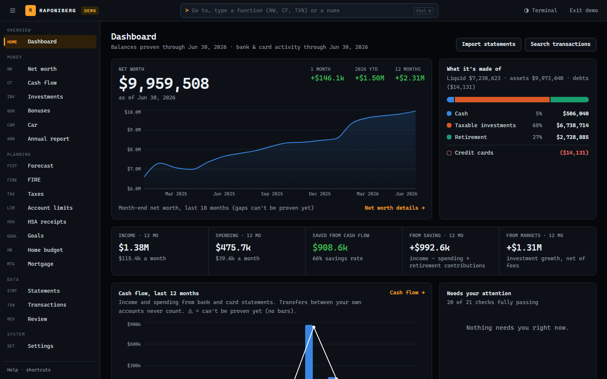
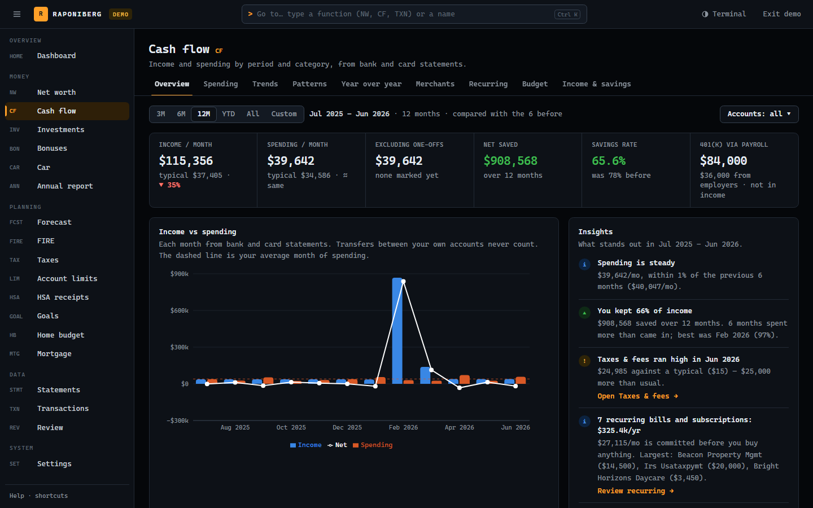
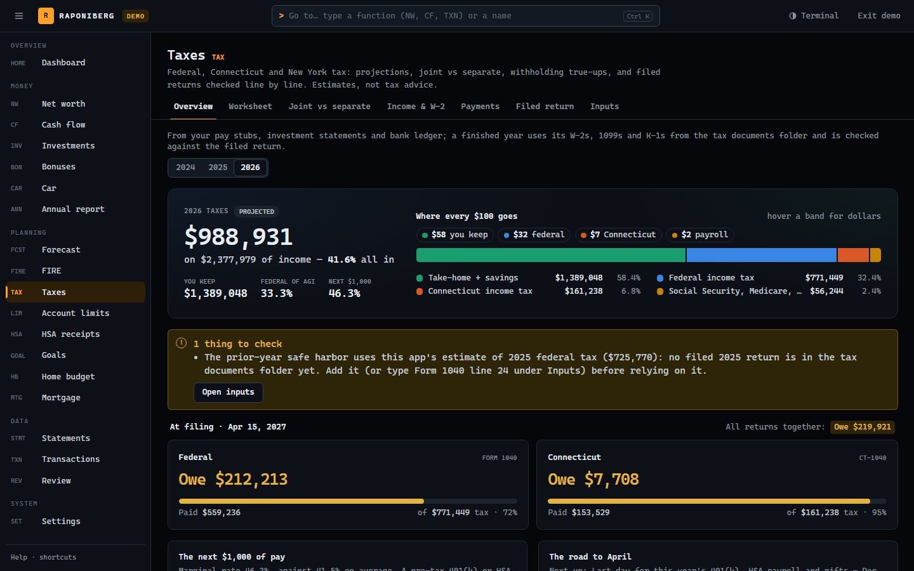
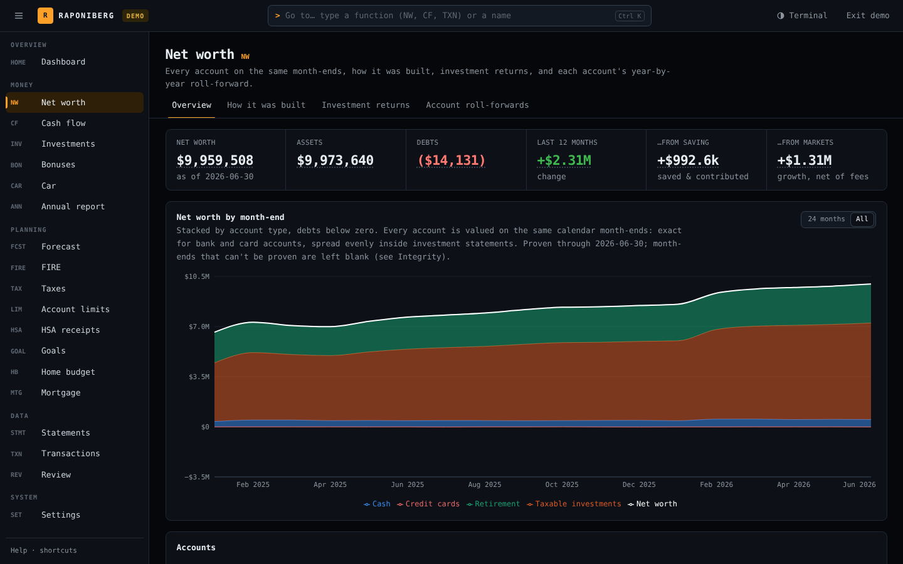
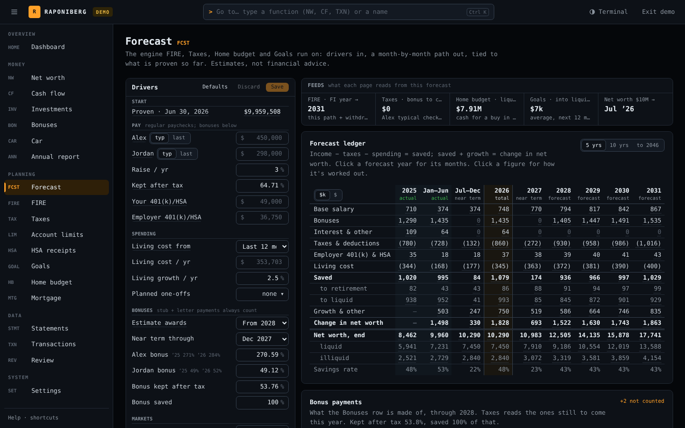

# Raponiberg

[](https://github.com/evancode7899/Raponiberg/actions/workflows/ci.yml)
[](LICENSE)

A private personal-finance app that runs on your own computer. You download your bank,
card, brokerage and pay statements as PDFs, and Raponiberg reads them into one ledger:
net worth, cash flow and spending, taxes, retirement (FIRE), home buying, mortgage
prepayment, bonuses, HSA receipts, car costs and yearly account limits. Every figure traces
back to a statement.

- **Private by design.** No bank logins, no aggregator, no cloud and no account to create.
  Your data stays in the app's `data/` folder on your computer.
- **Built for one household.** It runs on your computer for you (and a partner), not as a
  website for others.

> **Not advice.** Raponiberg is a bookkeeping and modeling tool, not financial,
> investment, tax or legal advice. Its numbers can be wrong. Check anything that matters
> with a qualified professional. You use it at your own risk, and the author isn't liable
> for any outcome (see the [License and disclaimer](#license-and-disclaimer)).



| Cash flow | Taxes | Net worth | Forecast |
|---|---|---|---|
|  |  |  |  |

<sub>Screenshots are from demo mode: a made-up household, not anyone's real finances.</sub>

## What it can read today

Raponiberg only imports statement layouts it has a parser for. If yours aren't listed,
those statements won't import yet (see [Adding a bank](#adding-a-bank)).

| Kind | Supported |
|------|-----------|
| Bank and savings | Chase checking, American Express High Yield Savings |
| Credit cards | Chase, American Express, Capital One, Bilt |
| Investments and retirement | Fidelity investment reports, Vanguard brokerage / IRA, Vanguard 401(k), Empower 401(k), Slavic401k, HealthEquity (HSA) |
| Pay stubs | ADP, TriNet, Vensure |
| Other | Private-fund (LP) capital statements; year-end tax forms and filed returns on the Taxes page |

**Taxes** model US federal income tax plus Connecticut, New York State and New York City.
Other states aren't modeled, so their state-tax figures will be missing or wrong.

**Computers:** Windows gets a desktop shortcut that starts the app with no terminal.
macOS and Linux work too, started from a terminal.

## Get started

You need about 10 minutes, and no programming experience.

1. **Install Node.js and Git.** Download the **LTS** version of Node.js from
   [nodejs.org](https://nodejs.org) (version 22.18 or newer), and Git from
   [git-scm.com](https://git-scm.com). Accept the defaults. Then open a **new** terminal
   (on Windows, PowerShell).
2. **Download Raponiberg.** On this repository's GitHub page, click the green **Code**
   button and copy the address. Then run this from the folder you want it in (on Windows,
   `C:\dev` is a good choice; avoid OneDrive folders, which break the build):

   ```bash
   git clone <the address you copied> raponiberg
   ```

3. **Install and set up:**

   ```bash
   cd raponiberg
   npm install
   npm run setup
   ```

   `npm run setup` creates your settings file (`.env`) and an empty database. On Windows
   it also puts a **Raponiberg** shortcut on your Desktop.
4. **Start it.**
   - **Windows:** double-click **Raponiberg** on the Desktop. The first start builds the
     app, which takes a few minutes. Your browser opens when it's ready.
   - **macOS / Linux:** run `npm run build` once, then `npm start`, and open
     <http://127.0.0.1:3000>.
5. **Unlock it.** The password is `password`. Change it under **Settings › General**.
   Type `demo` instead to explore a made-up household first (see
   [Demo mode](#demo-mode)).
6. **Add your statements.** Go to **Statements › Import** and upload PDFs. Or point
   `STATEMENTS_DIR` in `.env` at a folder of statements and click **Scan statements
   folder**. The Statements page lists what's missing for each account and which months
   each new statement would complete.

Stuck? On Windows, `npm run app:stop` stops a server that won't respond, and the
launcher's log is `data/logs/launcher.log`.

## Your data

| Piece | Location |
|--------|-----------|
| Ledger (accounts, transactions, settings, audit log, …) | `data/finance.db` |
| Your decisions that survive rebuilds (exceptions, transfer and row decisions, merchant rules, bonus letters, calculator inputs, app password, HSA receipts log) | `data/*.json` + `*.journal.jsonl` |
| Household facts the rules need (names as statements print them, a partner's accounts, private funds, local merchants, when finances merged) | `data/household.json` (optional; shape in [`household.example.json`](household.example.json)) |
| Stored statement PDFs | `data/statements/` (originals stay in `STATEMENTS_DIR`) |
| Filed tax returns and their forms, as read | `data/tax-documents.json` (the PDFs stay in `TAX_DOCS_DIR`) |
| Settings | `.env` (see [`.env.example`](.env.example)) |

- **Git never picks up `data/` or `.env`.** They're ignored, so they can't end up on
  GitHub.
- **Nothing is encrypted.** The app password only stops someone casually using your
  computer: it's stored in plain text, and the app's API doesn't check it. Forgot it?
  Delete `data/app-password.json` and it's `password` again.
- **Backups are optional.** Set `BACKUP_DIR` in `.env` to a folder that OneDrive,
  Dropbox or iCloud syncs. The app then copies `data/` there every 15 minutes while it
  runs (only when something changed) and when you close it with the power button. See
  [Backups](#backups).
- **Updates arrive as releases.** On Windows, each start through the shortcut checks
  GitHub for a newer **release** and moves to it, never touching your data. Work in
  progress between releases doesn't reach you. A copy you've customized doesn't update
  itself (see [Making it yours](#making-it-yours)). To turn updates off, run
  `setx RAPONIBERG_NO_UPDATE 1` and open the app again. To update by hand:
  `git fetch --tags`, then `git merge <newest vX.Y.Z>`, `npm install` and
  `npm run db:refresh`.

## Making it yours

Raponiberg is meant to be customized. Your copy is yours: change any page, rule or
calculation, add a parser for your bank, or remove what you don't use. This repository
doesn't take contributions back (see [CONTRIBUTING.md](CONTRIBUTING.md)).

- **Commit your changes with git** (`git add -A`, then `git commit -m "my change"`) so you
  can always undo them.
- **Once you commit your own changes, updates stop.** The desktop shortcut sees commits of
  your own and stops updating itself, so nothing of yours is ever overwritten.
  `data/logs/launcher.log` says so on each start.
- **To bring in a later release anyway**, merge it into your copy and fix any conflicts
  where you and the release changed the same lines:

  ```bash
  git fetch --tags
  git merge v0.2.0
  npm install
  npm run db:refresh
  ```

- **Publishing your copy** (to GitHub, or as a fork) is fine, but keep your data out of
  it. `data/` and `.env` are never included, and `npm run setup` turns on a check that
  runs before every `git push`. It stops the push if your own names, account numbers or
  amounts appear in the code. Use made-up values in tests, and screenshots from demo mode.
  When in doubt, keep the repository private.
- **The license still applies to your copy:** keep the name Raponiberg, and don't make
  money from it. AI coding assistants pick up these rules from [AGENTS.md](AGENTS.md).

## Demo mode

Type **demo** on the lock screen to show the app to someone without your data. It starts a
second copy of the app on port 3001 (a few seconds the first time) and opens it: a made-up
household with 2025 through June 2026 of statements, pay stubs, holdings and tax figures,
about $10M net worth and $2M a year of income. A **DEMO** tag sits next to the logo, and
**Exit demo** goes back to the lock screen.

- The demo reads only `data/demo` (its own database and files), rebuilt from scratch every
  time it starts, so anything changed there is gone next time. It never backs up and never
  reads the statements folder.
- The data comes from `src/lib/demo/generate.ts` and goes through the normal import path, so
  every integrity check passes; the only open items are the statements after June 2026 that
  a real household would still be waiting for.
- Shutting the app down (power button) stops the demo too; the launcher and
  `npm run app:stop` stop a demo left running.
- From a terminal: `npm run demo` (`-- --dev` for a dev server, `-- --build-only` to just
  rebuild `data/demo`).

## HSA receipts

**HSA receipts** (Planning › HSA, or type `HSA`) is the log of medical bills paid out of
pocket and left for the HSA to reimburse later, so the account stays invested:

- **Receipts**: add expenses by hand or from statements; sort by date or amount. Each
  reimbursed one says how it was marked (tied to which distribution, or by hand) and can be
  undone on its row. Expenses added from charges that don't look medical (filed under
  groceries, dining, shopping…) are flagged and left out of the totals until you keep or
  remove them.
- **Found in statements** lists card and bank charges that look like qualified care
  (doctors, dental, vision, labs, hospitals; drug stores as "check the receipt") and aren't
  logged yet. The name has to say medical care and the charge can't be filed somewhere
  plainly not medical. Add them, or set aside a charge or a whole merchant for good.
- **Reimburse**: select expenses and mark them reimbursed (date, note, and the HSA
  distribution that paid them once its statement is imported); the planner picks the oldest
  receipts that add up to a distribution you want to take. Money out of the HSA is either a
  distribution to your bank (what reimburses receipts) or the HSA's card paying a provider
  directly (nothing to reimburse, never tied to the log). A distribution that some receipts
  add up to exactly is offered for review, never tied without you confirming.
- **Growth & strategy**: what waiting has earned, the backlog's value in the year you plan
  to draw it down vs. a taxable account, and the three ways to pay a medical bill.

The log is `data/hsa-expenses.json` (with its journal), backed up like the other files.

## The desktop app (Windows)

`npm run setup` makes the Desktop shortcut. To make it again, or to start Raponiberg
automatically when you sign in to Windows:

```powershell
npm run desktop:shortcut   # the "Raponiberg" shortcut on your Desktop
npm run logon:register     # optional: also start it at Windows sign-in
```

Double-click **Raponiberg**. When the server isn't running, it first updates to the newest
release (see [Your data](#your-data)), backs up if anything new arrived, and reinstalls,
migrates or rebuilds whatever changed. Then it starts the server with no console window
and opens your browser. Offline, or when GitHub doesn't answer, it just starts the version
already there. While it works, a small loading window shows
each step with a progress bar. Close the app with the **power button** in its top bar
(it backs up first); opening it again picks up updates. Logs go to `data/logs/`
(`launcher.log` has the summary).

## Backups

With `BACKUP_DIR` set, the app backs up `data/finance.db` and every file in `data/` there
every 15 minutes while it runs (only when something changed), and when you close it with
the power button. Without `BACKUP_DIR` it uses `Backup` beside your statements
folder, or `OneDrive\Raponiberg\Backup` when `OneDrive\Raponiberg` exists,
and otherwise it doesn't back up. **Settings › Data › Cloud backup** shows the latest
snapshot and has **Back up now**.

| Task | Command |
|------|---------|
| Back up now | `npm run backup` |
| List snapshots | `npm run restore -- --list` |
| Restore the newest (app stopped; current data is kept in `data/backups/pre-restore_*`) | `npm run restore` |
| Restore a specific one | `npm run restore -- 2026-10-09_22-15-03` |

**New or wiped computer:** install Node.js and Git, let the backup folder sync, clone the
repository again, then run `npm install` and `npm run setup -- --from "<backup folder>"`.
Setup restores the newest snapshot and migrates it. [SETUP.md](SETUP.md) walks through it.

## Adding a bank

Each institution has a deterministic parser in
[`src/lib/ingest/parsers`](src/lib/ingest/parsers), registered in its `index.ts`. A new
institution is a new parser file plus one entry there. Anything no parser recognizes goes
to a manual path instead of being guessed at. Check a folder of statements against the
parsers without touching the database:

```bash
npm run statements:check -- "<folder of PDFs>"
```

## Keeping the code free of personal data

Nothing personal belongs in the code: names, account numbers, employers, places and
figures live in `data/`, which git ignores as a whole. Before publishing, run:

```bash
npm run privacy:check
```

It scans every file a public copy would contain for this computer's own personal terms
and fails on any hit. The terms come from:
- `data/household.json`
- the database: names, employers, account numbers, exact amounts, real charges written
  next to their own date, and saved settings
- bonus letters, calculator figures, tax documents and the HSA receipts log

It also fails if the database exists but can't be read, so a check that couldn't run is
never mistaken for a pass. Test fixtures must use made-up names and numbers, never ones
copied from a statement.

To publish a copy with no history, see
[SETUP.md › Publishing a fresh copy](SETUP.md#publishing-a-fresh-copy).

## Operations cheat sheet

| Task | Command / URL |
|------|----------------|
| Development server | `npm run dev` |
| Production build (Turbopack; webpack fallback: `npm run build:webpack`, `npm run dev:webpack`) | `npm run build` |
| DB browser | `npm run db:studio` (or Settings › Data › Database browser) |
| Local DB copy (checkpoint + integrity + copy into `data/backups/`) | `npm run db:backup` |
| Migrate after pulling code | `npm run db:refresh` |
| Safer dev migration (backup first) | `npm run db:migrate:safe` |
| Health + counts + recent migrations | [GET /api/health/db](http://127.0.0.1:3000/api/health/db) |
| Tests | `npm test` |

Statement imports, settings changes, backups and exports append rows to the audit log:
**Settings › Audit** shows it and downloads it as CSV.

## License and disclaimer

Free to use, copy, modify and share, but **no making money from it**: no selling it,
charging for access or hosting, paid tiers, ads, sponsorships, or using it for paid client
work. Running your own household's finances with it is fine.

**Disclaimer.** Raponiberg is not financial, investment, tax, accounting or legal advice,
and its author is not your adviser. Its figures, forecasts and tax estimates can be
incomplete or wrong. You alone are responsible for checking them and for every decision
you make with them. **The author accepts no liability** for any loss or consequence of
using it, including:
- investment losses
- taxes, penalties or interest
- filing mistakes or legal consequences
- loss or exposure of your data

The full terms, which control, are in [LICENSE](LICENSE). AI coding assistants follow the
same rules through [AGENTS.md](AGENTS.md).
